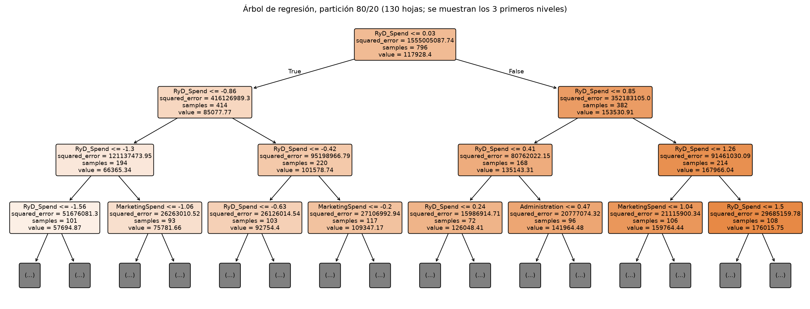

## Parte A: Regresión

### Datos y preparación

El dataset `1000_Companies.csv` tiene 1000 empresas, con tres gastos (`RyD_Spend`, `Administration` y `MarketingSpend`), el estado (`State`) y la ganancia, `Profit`, que es la variable a estimar. No tiene valores faltantes.

**Limpieza:**

- **Eliminamos 1 fila duplicada** (la 755 repite la 335).
- **Eliminamos los 3 atípicos de `Profit`:** las últimas tres filas del archivo (997 a 999). Su ganancia llega a 476.000 dólares, 2,5 veces la mayor del resto (192.000), y tienen los tres valores más altos de `Administration`. No siguen la relación con los gastos que tienen las demás empresas, así que los tratamos como errores de carga.
- **Conservamos los 19 atípicos de `Administration`.** Están todos entre las primeras 50 filas del archivo, donde esa variable varía mucho más (desvío de 28.000 contra 6.900 en el resto). Son montos posibles.

Quedan 996 empresas.

**Correlaciones (datos limpios):**

- `Profit` está casi perfectamente correlacionada con `RyD_Spend` (0,999).
- También está muy correlacionada con `MarketingSpend` (0,98), y bastante menos con `Administration` (0,75).
- `RyD_Spend` y `MarketingSpend` están muy correlacionadas entre sí (0,98).

**Preparación para el modelo:**

- `State` se codificó con `OrdinalEncoder`.
- Dividimos en 80/20 (796 empresas de entrenamiento y 200 de test) y 70/30 (697 y 299), con `random_state = 63`.
- Los tres gastos se estandarizaron con la media y el desvío del entrenamiento de cada partición. `Profit` quedó en dólares.

### Elección del árbol

Probamos las 36 combinaciones de `max_depth` ∈ {3, 5, 10, sin límite}, `min_samples_leaf` ∈ {1, 5, 10} y `min_samples_split` ∈ {2, 10, 20}. Las medimos con el RMSE de validación cruzada de 5 particiones **sobre el entrenamiento**, y dejamos el test solo para el resultado final.

**Criterio:** entre las configuraciones a menos del 1 % del mejor RMSE de validación, elegimos la de menos hojas. Lo necesitamos porque, con 80/20, la de menor RMSE (2.176) es un árbol con `min_samples_leaf = 1` y 601 hojas, que casi memoriza el entrenamiento: su RMSE de entrenamiento es de 31 dólares. Con `min_samples_leaf = 5`, el RMSE de validación es de 2.179, apenas 3 dólares más, con 130 hojas.

**La configuración elegida es la misma en las dos particiones:** `max_depth = 10`, `min_samples_leaf = 5` y `min_samples_split = 2`.

- **La profundidad es lo que más importa:** el RMSE de validación baja de unos 5.500 dólares con 3 niveles a unos 2.200 con 10, y no cambia sin límite.
- **Las hojas de una sola empresa empeoran el error:** con 70/30, el RMSE de validación sube de 2.261 a cerca de 3.000.

### Resultados

| Partición | Hojas | RMSE validación | RMSE entrenamiento | MAE test | MSE test | RMSE test |
|---|---|---|---|---|---|---|
| 80/20 | 130 | 2.179 | 1.315 | 1.100 | 12.193.387 | 3.492 |
| 70/30 | 106 | 2.261 | 1.439 | 925 | 7.652.547 | 2.766 |

Los errores están en dólares, y el MSE, en dólares al cuadrado. El RMSE de test es menos de una décima parte del desvío de `Profit` (unos 41.000 dólares).

**El árbol se apoya casi solo en `RyD_Spend`:**

- Los tres primeros niveles cortan solo por esa variable (el primer corte es en 82.150 dólares), y su importancia es de 0,99, coherente con la correlación de 0,999.
- `MarketingSpend` y `Administration` recién aparecen en el cuarto nivel, y `State` no se usa.

**Casi todo el error se concentra en unas pocas empresas:**

- En el 88 % de las empresas de los dos test, el error es menor a 1.000 dólares.
- Los errores grandes son todos de empresas de las primeras 50 filas del archivo: aportan el 98 % del error cuadrático en el test 80/20 (14 empresas) y el 96 % en el 70/30 (16 empresas).
- Por eso el RMSE es unas tres veces el MAE. La diferencia entre las particiones depende de cuáles de esas empresas caen en cada test, más que de la cantidad de datos de entrenamiento.

## Parte B: Clasificación

### Datos y preparación

El dataset `drugType.csv` tiene 200 pacientes y 5 atributos:

- dos numéricos: `Edad` y `Na_a_K`, la relación sodio/potasio;
- tres categóricos: `Sexo`, `BP` (presión arterial) y `Colesterol`.

El objetivo, `Droga`, tiene 5 clases. No hay valores faltantes ni filas duplicadas.

**Las clases están desbalanceadas:** `DrogaY` es el 45,5 % de los pacientes, `DrogaX` el 27 %, `DrogaA` el 11,5 % y `DrogaB` y `DrogaC`, el 8 % cada una. Por eso estratificamos las particiones y elegimos los hiperparámetros con el F1 macro de validación cruzada (5 particiones del entrenamiento), que pesa igual a todas las clases.

**Lo que muestra el análisis exploratorio:**

- **`Na_a_K` separa a `DrogaY`:** sus pacientes tienen siempre 15,0 o más, y los de las otras drogas, 14,6 o menos.
- **`Edad` separa a `DrogaA` (hasta 50 años) de `DrogaB` (desde 51).**
- **La presión ordena el resto:** con presión alta solo aparecen `DrogaA`, `DrogaB` y `DrogaY`, y `DrogaC` aparece solo con presión baja y colesterol alto.
- **`Sexo` se reparte igual en todas las drogas.**
- **Los atributos son prácticamente independientes:** sus correlaciones de Spearman van de −0,15 a 0,10.
- **`Na_a_K` tiene 8 atípicos, todos de `DrogaY`** (de 32,9 a 38,2). Los conservamos, porque son valores posibles y caen justamente del lado que identifica a esa clase.

**Preparación para los modelos:**

- Las categóricas se codificaron con su orden natural (por ejemplo, `BP`: Bajo = 0, Normal = 1 y Alto = 2).
- Las particiones son 80/20 (160 pacientes de entrenamiento y 40 de test) y 70/30 (140 y 60), con `random_state = 63`.
- `Edad` y `Na_a_K` se estandarizaron con el entrenamiento.
- Los test son chicos: tienen solo 3 y 5 pacientes de `DrogaB` y de `DrogaC`.

### Árbol de decisión y post-poda

**Grilla:** `max_depth` ∈ {2, 4, 6, sin límite}, `min_samples_leaf` ∈ {1, 3, 5} y `min_samples_split` ∈ {2, 5, 10}.

- Con `max_depth = 2`, el árbol tiene 3 hojas para 5 clases, y el F1 macro queda en 0,52.
- **Desde `max_depth = 4`, las 27 combinaciones dan el mismo árbol de 6 hojas** (F1 macro de 0,966 con 80/20 y 0,965 con 70/30). Elegimos la más simple, `max_depth = 4`.

**Post-poda:** medimos con validación cruzada cada valor de `ccp_alpha` del camino de poda.

| Partición | ccp_alpha | Hojas | F1 macro validación |
|---|---|---|---|
| 80/20 | 0 | 6 | **0,966** |
| | 0,062 | 4 | 0,828 |
| | 0,094 | 3 | 0,596 |
| 70/30 | 0 | 6 | **0,965** |
| | 0,061 | 4 | 0,918 |
| | 0,093 | 3 | 0,662 |

**Elegimos `ccp_alpha = 0`, es decir, no podar.** Cada hoja del árbol separa una clase, así que cualquier poda pierde una clase entera. La primera poda junta en una hoja de `DrogaX` toda la rama de presión baja o normal, y deja mal clasificados a los 13 pacientes de `DrogaC` del entrenamiento.

**El árbol son 5 reglas:**

- `DrogaY` si `Na_a_K` > 14,83;
- si no, `DrogaA` con presión alta y hasta 50 años, y `DrogaB` con presión alta y más de 50;
- `DrogaC` con presión baja y colesterol alto;
- `DrogaX` en el resto.

**No usa `Sexo`.** En los dos test clasifica bien a todos los pacientes: exactitud, precisión macro y exhaustividad macro de 1.

### Bayes ingenuo

Discretizamos `Edad` y `Na_a_K` por igual frecuencia (cuantiles), con 3 y 5 intervalos, y aplicamos `CategoricalNB` a los cinco atributos. El discretizador va dentro de un pipeline, para que los cortes se calculen solo con el entrenamiento.

| Partición | Intervalos | F1 macro validación | Accuracy | Precision macro | Recall macro |
|---|---|---|---|---|---|
| 80/20 | 3 | 0,691 | 0,825 | 0,830 | 0,811 |
| 80/20 | **5** | **0,811** | 0,925 | 0,926 | 0,967 |
| 70/30 | 3 | 0,639 | 0,850 | 0,902 | 0,830 |
| 70/30 | **5** | **0,761** | 0,917 | 0,900 | 0,963 |

**5 intervalos funcionan mejor porque sus cortes se acercan más a las fronteras de las clases:**

- Con 3 intervalos, el del medio de `Na_a_K` va de 11,4 a 18,3, y mezcla a `DrogaY` con las demás. Con 5, el intervalo mezclado se achica a 12,8–16,1.
- En `Edad`, uno de los cortes con 5 intervalos cae justo en 50, la frontera entre `DrogaA` y `DrogaB`.

**Todos los errores son pacientes de `DrogaY` con `Na_a_K` entre 15,2 y 15,8** (3 en el test 80/20 y 5 en el 70/30). Caen en el intervalo mezclado, y el modelo los asigna a la droga que sugieren su presión, su colesterol y su edad.

### k-NN

**Grilla:** k ∈ {1, 3, 5, 7, 9}, con las distancias euclidiana y Manhattan.

- **La elección de k es inestable.** Gana Manhattan en las dos particiones, pero con k = 1 en la 80/20 (F1 macro de validación de 0,874) y k = 9 en la 70/30 (0,818). Las curvas de validación van en zigzag porque cada pliegue tiene solo 2 o 3 pacientes de `DrogaB` y de `DrogaC`.
- **Manhattan le gana a la euclidiana en 8 de las 10 combinaciones.**

k-NN se equivoca con 5 pacientes en cada test. Casi todos están cerca de la frontera de `Na_a_K`: pacientes de `DrogaY` con valores de 15,2 a 16,6, clasificados como otra droga, y al revés. La distancia mezcla `Na_a_K` con los demás atributos, incluido `Sexo`, que no ayuda a distinguir las drogas.

### Comparación y modelo elegido

| Partición | Modelo | Accuracy | Precision macro | Recall macro |
|---|---|---|---|---|
| 80/20 | **Árbol (max_depth = 4, 6 hojas, sin poda)** | **1,000** | **1,000** | **1,000** |
| | Bayes ingenuo (5 intervalos) | 0,925 | 0,926 | 0,967 |
| | k-NN (Manhattan, k = 1) | 0,875 | 0,870 | 0,937 |
| 70/30 | **Árbol (max_depth = 4, 6 hojas, sin poda)** | **1,000** | **1,000** | **1,000** |
| | Bayes ingenuo (5 intervalos) | 0,917 | 0,900 | 0,963 |
| | k-NN (Manhattan, k = 9) | 0,917 | 0,935 | 0,930 |

**Elegimos el árbol de decisión.**

- **Tiene las mejores métricas en las dos particiones.**
- **Es el más interpretable:** son 5 reglas con umbrales que un médico puede leer y comprobar. Bayes da probabilidades por intervalo, y k-NN no da reglas: solo puede justificar cada predicción con los pacientes parecidos.
- **Su forma coincide con la de los datos:** cada droga se define por umbrales sobre un atributo a la vez, que es justamente el tipo de frontera que construye un árbol.

Bayes pierde información al discretizar con cortes que no coinciden con esas fronteras, y k-NN las desdibuja al mezclar los atributos en una distancia. Con test de 40 y 60 pacientes, el 1 del árbol en test es optimista: su F1 macro de validación cruzada, de 0,965 a 0,966, es una estimación más prudente.

## Conclusiones

**En la regresión:**

- **La ganancia depende casi solo del gasto en I+D.** El mejor árbol (`max_depth = 10`, `min_samples_leaf = 5`) tiene en test un RMSE de 3.492 y 2.766 dólares (80/20 y 70/30).
- **Dos decisiones fueron importantes:**
    - limpiar las 3 empresas con ganancias imposibles;
    - preferir, entre configuraciones empatadas, el árbol con menos hojas, que evitó uno de 601 hojas que memorizaba el entrenamiento.
- Casi todo el error restante viene de las primeras 50 filas del archivo, más heterogéneas que el resto.

**En la clasificación:**

- **Las drogas siguen reglas simples**, sobre la relación sodio/potasio, la presión, la edad y el colesterol.
- **El árbol las encuentra con 6 hojas y clasifica bien todo el test.** La post-poda no lo mejora, porque cada hoja separa una clase.
- **Bayes ingenuo y k-NN fallan con los mismos pacientes:** los de `DrogaY` con una relación sodio/potasio apenas mayor a 14,83.

**Las particiones 80/20 y 70/30 dieron resultados parecidos.** Sus diferencias dependen de qué casos difíciles caen en cada test, más que de la cantidad de datos de entrenamiento.

### Uso de asistentes de IA

Usamos un asistente de IA para escribir el código del notebook y un primer borrador de las interpretaciones y de este informe. El grupo revisó las decisiones de limpieza, los criterios de elección de los modelos, los resultados y las conclusiones, y es responsable de su contenido.
